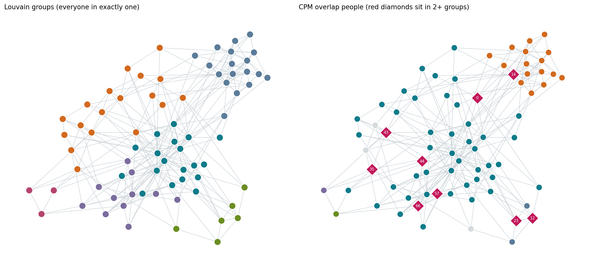
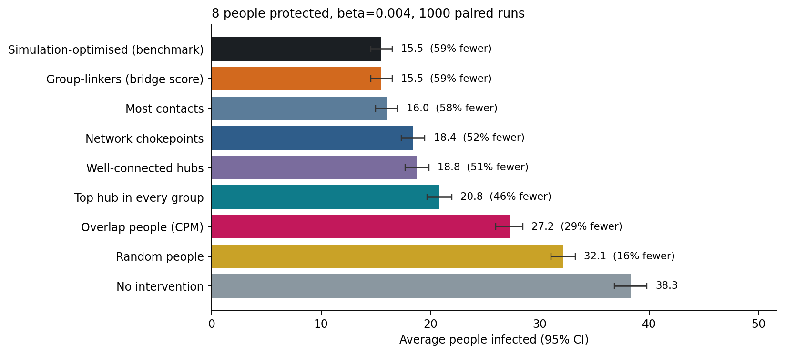
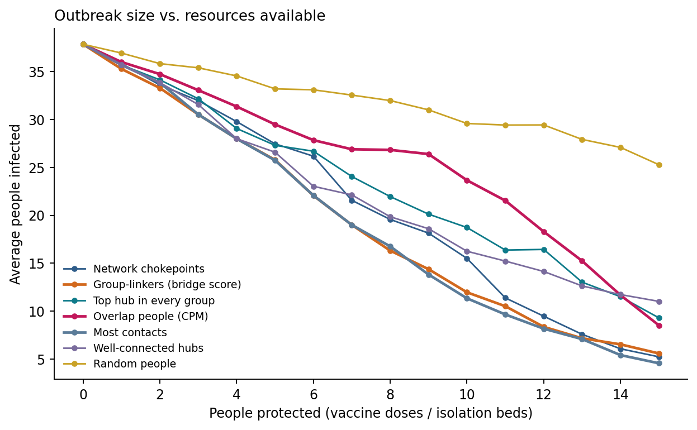
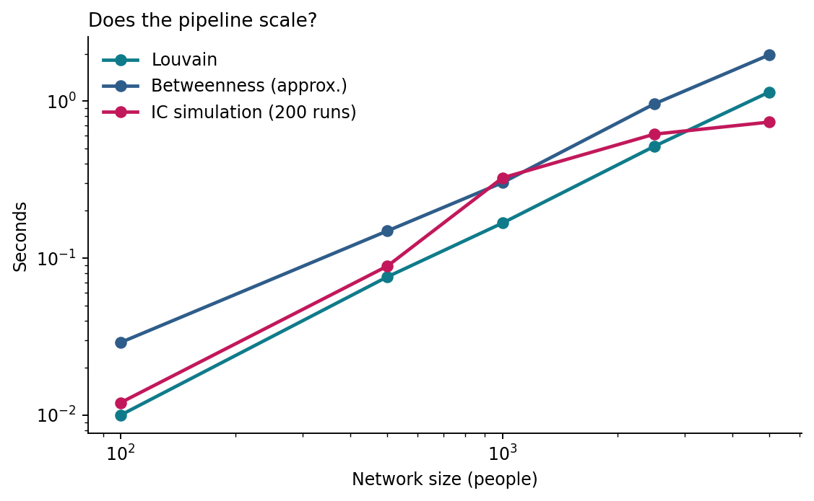

# ContainNet results

Auto-generated by `python scripts/run_all.py`. Do not edit by hand; re-run the pipeline instead.

**Setup.** Hospital ward contact network (SocioPatterns, Lyon 2010): 75 people,
1139 contact pairs. Transmission hazard beta = 0.004 per 20-second contact interval,
1000 paired Monte Carlo runs per strategy, budget = 8 people protected,
1 random patient zero (never someone already protected).

## 1. Community structure: Louvain vs Girvan-Newman vs Clique Percolation

| method | communities | largest | avg_size | people_covered | people_in_2plus | modularity | within_group_contact | nmi_vs_roles | runtime_s |
|---|---|---|---|---|---|---|---|---|---|
| Louvain (full graph) | 6 | 19 | 12.500 | 75 | 0 | 0.368 | 0.614 | 0.280 | 0.307 |
| Girvan-Newman (backbone) | 6 | 31 | 12.500 | 75 | 0 | 0.437 | 0.656 | 0.278 | 0.966 |
| CPM k=3 (full graph) | 1 | 75 | 75.000 | 75 | 0 |  | 1.000 |  | 1.843 |
| CPM k=3 (backbone) | 5 | 52 | 16.200 | 72 | 9 |  | 0.790 |  | 0.002 |

CPM on the raw graph merges all 75 people into one community because the ward graph is very dense
(41% of all pairs are linked). Keeping each person's
4 strongest contacts (the *backbone*) lets CPM find 5 overlapping communities with
9 people who belong to more than one.

## 2. Outbreak size under each intervention (budget = 8)

| Strategy | Protected | Avg infected | ±95% CI | Fewer infected (%) | ±CI (pts) | Gain over random (pts) |
|---|---|---|---|---|---|---|
| No intervention | 0 | 38.28 | 1.48 | 0.00 | 0.00 |  |
| Random people | 8 | 32.14 | 1.10 | 16.05 | 1.17 | 0.00 |
| Most contacts | 8 | 16.00 | 1.00 | 58.21 | 3.12 | 42.16 |
| Network chokepoints | 8 | 18.40 | 1.07 | 51.92 | 3.00 | 35.88 |
| Well-connected hubs | 8 | 18.77 | 1.08 | 50.97 | 2.95 | 34.92 |
| Top hub in every group | 8 | 20.81 | 1.13 | 45.64 | 2.86 | 29.59 |
| Group-linkers (bridge score) | 8 | 15.51 | 0.98 | 59.49 | 3.16 | 43.45 |
| Overlap people (CPM) | 8 | 27.21 | 1.24 | 28.92 | 2.23 | 12.87 |
| Simulation-optimised (benchmark) | 8 | 15.51 | 0.98 | 59.49 | 3.16 | 43.45 |

Best practical strategy: **Group-linkers (bridge score)** (59% fewer infections vs. 16% for random).
Simulation-optimised benchmark: 59%.

## 3. Which centrality predicts real spreading power?

Spearman correlation between each measure and the simulated outbreak size when that person is patient zero:

| measure | spearman_with_simulated_spread |
|---|---|
| strength | 0.986 |
| bridge_score | 0.946 |
| eigenvector | 0.927 |
| contacts | 0.896 |
| k_core | 0.828 |
| betweenness | 0.711 |
| participation | -0.208 |

## 4. Scalability (synthetic networks)

| nodes | edges | louvain_s | centrality_s | ic_s |
|---|---|---|---|---|
| 100 | 721 | 0.010 | 0.029 | 0.012 |
| 500 | 4063 | 0.076 | 0.149 | 0.089 |
| 1000 | 8398 | 0.167 | 0.302 | 0.324 |
| 2500 | 20810 | 0.515 | 0.959 | 0.615 |
| 5000 | 42090 | 1.141 | 1.968 | 0.734 |

## 5. Honest limitations

- One ward, 75 people, 4 days: the *ranking* of strategies is more trustworthy than the exact percentages.
- Weights are aggregated over four days, so timing (who met whom *when*) is ignored.
- CPM is very sensitive to graph density and to k (see `cpm_sweep.csv`); overlap alone is a weak spreader signal.
- Vaccination is modelled as perfect, instant removal.
